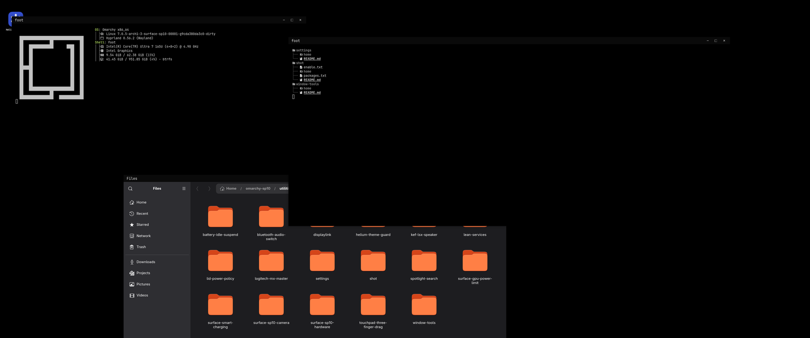
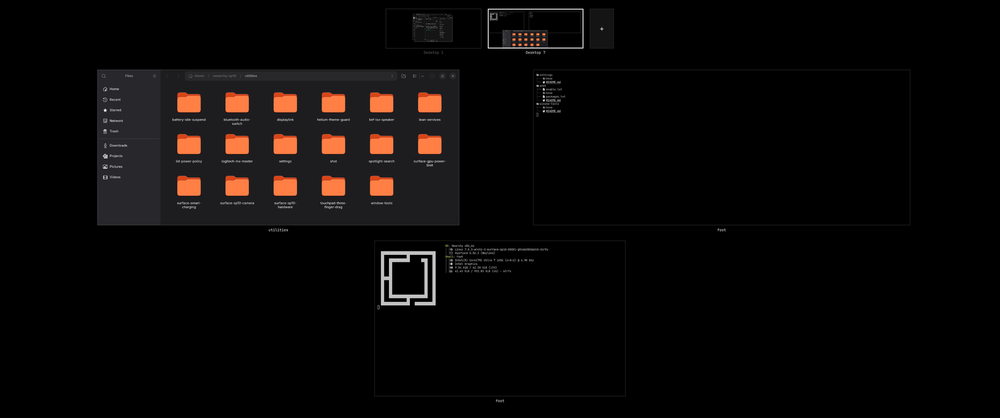
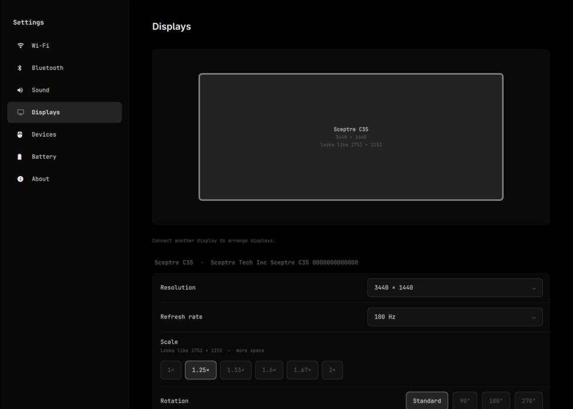
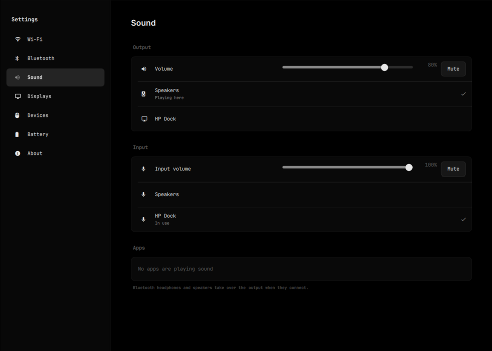
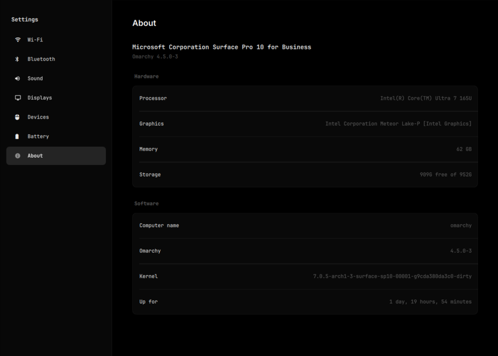

# Omarchy utilities

Small, self-contained add-ons for [Omarchy](https://omarchy.org) that make it
feel more like macOS: Mission Control, a real Alt+Tab, window snapping, a
Settings app, a screenshot tool, and fixes for specific hardware. Each one
lives in its own folder and installs on its own onto a stock Omarchy, so take
only what you want.

Built and used daily on Omarchy 4.5 with Hyprland 0.56.



**Mission Control** (4-finger swipe up or Ctrl+Up): every window on the
desktop, with the desktops along the top.



**Settings**: one window for Wi-Fi, Bluetooth, Sound, Displays, Devices,
Battery and About.

| Displays | Sound | About |
|---|---|---|
|  |  |  |

## Install

```bash
git clone https://github.com/Rohansguliani/omarchy-sp10 ~/omarchy-utilities
cd ~/omarchy-utilities

./install.sh --only window-tools --dry-run   # see what it would change
./install.sh --only window-tools             # install one utility
./install.sh --only window-tools,settings,shot
```

`--only` installs a utility's config files, packages, services and shell
plugins, and turns its plugins on. It doesn't touch your theme or other
settings. Any file it replaces is backed up to
`~/.local/state/omarchy-setup/backup-<time>/`, and it's safe to rerun.

## Utilities

### For any machine

| Utility | What it does | Why |
|---|---|---|
| [`window-tools`](utilities/window-tools) | **Mission Control** (4-finger swipe up or Ctrl+Up): every window on the desktop, plus a row of desktops you can switch to, reorder, close, or drop windows onto. **Alt+Tab** with live thumbnails for the current desktop. **Snapping**: Alt+Left/Right for halves, Alt+A to maximize, Alt+=/− to resize two windows along their shared edge, drag to a screen edge to snap. Side-only edge resizing. Desktop switching that skips empty desktops and can link several monitors into one desktop. | Omarchy's floating mode has no overview, no window switcher with previews, and maximize that undoes itself when another window opens. |
| [`settings`](utilities/settings) | A **Settings** window: Wi-Fi (connected, saved, nearby), Bluetooth (connected, paired, nearby), Sound (output, input, per-app volume), Displays (drag to arrange, resolution, refresh, scale, rotation, with Keep/Revert), Devices (per-mouse and per-keyboard speed and scrolling), Battery, About. Plus a macOS-style **Sound menu** in the bar. | Omarchy spreads these over terminal apps and bar pop-ups; this puts them in one fast window drawn by Omarchy's own shell. |
| [`shot`](utilities/shot) | **Alt+1** screenshot of an area to the clipboard, **Alt+2** copies the text in an area (OCR, offline), **Alt+`** opens the last shot in an editor (arrow, box, pen, text, pixelate). | A resident daemon, so the overlay shows in about 0.1 s with a pixel-exact frozen frame and no clutter on screen. |
| [`spotlight-search`](utilities/spotlight-search) | Settings for the [Spotlight](https://github.com/maajix/omarchy-spotlight) launcher on Ctrl+Space, and a search ignore list. | Keeps source checkouts and caches out of file results. |
| [`bluetooth-audio-switch`](utilities/bluetooth-audio-switch) | Sound moves to Bluetooth headphones or speakers as soon as they connect. | PipeWire keeps playing to the last output, so headphones that reconnect on their own stay silent. |
| [`helium-theme-guard`](utilities/helium-theme-guard) | Removes Omarchy's Chromium color policy whenever it reappears. | That policy overrides the theme of the Helium browser and turns it gray. |
| [`lean-services`](utilities/lean-services) | Masks Omarchy's crash watcher and makes printing (CUPS) start on demand. | Both run all the time on machines that don't need them. |

### Laptops and input devices

| Utility | What it does | Needs |
|---|---|---|
| [`lid-power-policy`](utilities/lid-power-policy) | Lid closed: sleeps on battery, keeps running with the internal screen off on power, and moves to the external monitor when one is connected. Rechecks while closed, so unplugging still does the right thing. | a laptop |
| [`battery-idle-suspend`](utilities/battery-idle-suspend) | Sleeps after 10 minutes locked on battery. Omarchy otherwise only locks and turns the screen off. | a laptop |
| [`touchpad-three-finger-drag`](utilities/touchpad-three-finger-drag) | A patched libinput that makes three-finger drag start and drop immediately, like macOS. | a touchpad |
| [`logitech-mx-master`](utilities/logitech-mx-master) | Gesture button opens Mission Control, thumb wheel switches desktops. A small Python script talking to the mouse directly; no Solaar. | MX Master 2S on a Unifying receiver |
| [`displaylink`](utilities/displaylink) | DisplayLink driver and placement for USB docks. | a DisplayLink dock |
| [`kef-lsx-speaker`](utilities/kef-lsx-speaker) | Keeps the KEF LSX II LT's USB audio from suspending, which locks up its firmware. | that speaker |

### Surface devices only

These change the kernel, boot options or firmware power limits. **Install them
only on the hardware named; on anything else they're wrong and can be harmful.**

| Utility | What it does | Hardware |
|---|---|---|
| [`surface-sp10-camera`](utilities/surface-sp10-camera) | A custom kernel (Arch 7.0.5 plus Surface Pro 10 camera patches) and a patched libcamera, so both built-in cameras work. Pins libcamera so updates don't replace it. Building the kernel takes about an hour. | Surface Pro 10 for Business |
| [`surface-sp10-hardware`](utilities/surface-sp10-hardware) | Turns panel self-refresh off (removes display lag) and fixes power-button wake. | Surface Pro 10 for Business |
| [`surface-gpu-power-limit`](utilities/surface-gpu-power-limit) | Raises the firmware's 45 W peak power limit to 64 W, which roughly doubles the GPU's real clock under load. | Surface Pro 10 for Business |
| [`surface-smart-charging`](utilities/surface-smart-charging) | Keeps Surface Smart Charging paused so the battery charges to 100% instead of holding at 80%. | Surface devices |

Each utility's own README explains how it works, which files it adds, and how to
undo it.

## Setting up a whole machine

`machines/<name>/` describes one machine: the utilities it gets
(`utilities.txt`), its hardware packages, and its monitor and input settings.
`install.sh <name>` applies the shared config in `home/` (theme, bar, terminals,
Hyprland look and feel), every listed utility, and that machine's folder. It
remembers the name, so later runs are just `./install.sh`.

`machines/sp10/` is the included example, a Surface Pro 10. For another machine,
copy it, keep only what fits the hardware, and see [`AGENTS.md`](AGENTS.md) for
the rules (written so an AI agent on that machine can do it).

After changing something on a machine, `./capture.sh` copies the live files
back into the repo. `install.sh` won't overwrite a live file that is newer than
the repo copy unless you pass `--force`.

## How a utility is laid out

```text
utilities/<name>/
  README.md        what, why, files, how to undo
  home/            copied into ~ (Hyprland settings go in home/.config/hypr/utilities/<name>.lua)
  system/          copied into / with sudo
  packages.txt     repo and AUR packages
  plugins.txt      third-party shell plugins, pinned to a commit
  enable.txt       services to enable ("user <unit>" or "system <unit>")
  pkg/*/PKGBUILD   locally patched packages to build
  setup.sh         anything files can't do; idempotent and respects --dry-run
```

Everything except the README is optional.
